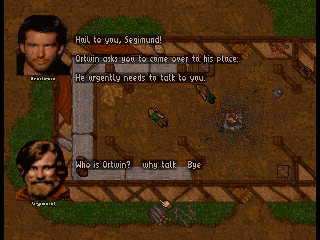

# Teudogar

Teudogar and the Alliance with Rome is a historical role-playing game
set in ancient Germania. Wolf Mittag released it for Windows in 2003.

This repository recovers the source of its last version, 1.05 of 2008.
Watcom C/C++ 11.0 compiles it back into the original programs.

We converted the code to standard C99. The same source now builds the
game for today's Linux, macOS, and Windows on
[SDL3](https://www.libsdl.org/), with fixes of its gameplay and its
texts, and in French.



## Changes from the original

`make original` builds the programs of 2008. The other builds change
the game.

The game on SDL3:

- It runs on Linux and Windows, in 32 and 64 bits, and on macOS, on
  Apple silicon and Intel Macs. The original needs the 8-bit display
  modes of DirectDraw, which Windows 8 dropped.
- It plays in a window or on the full screen, at any size.
- Its wide view covers the width of the output with the map, up to
  32:9. The original's 4:3 stays the default.
- Its music plays through [FluidSynth](https://www.fluidsynth.org/),
  with the SoundFont
  [GeneralUser GS](https://github.com/mrbumpy409/GeneralUser-GS).
- It keeps the saved games and the settings in the user's own folder.
- It writes each file of that folder whole. A write that fails, as on
  a full disk, then keeps the old file, which the original empties at
  its open.

The features, in the Watcom program and on SDL3 alike:

- `french`: the game in French, translated from the German.
- `errata`: fixes of the German, English, and Italian texts.
- `faults`: fixes of the code's reads and writes past their objects,
  of formats that lack their arguments, and of a division by 0.
- `pace`: the same pace at any refresh, which the original leaves to
  the display.
- `fixes`: fixes of the gameplay, with `faults` and `pace`. Back of the
  save menu cancels, where the original saves over the AutoSave, and a
  save that fails keeps the old one.
- `slots`: 23 slots of saved games and three AutoSaves in three pages,
  where the original has nine and one. A save takes a note, and
  Shift+S saves at once.

`ddraw.dll` runs the release's `teudogar.exe`, and the rebuilt one, on
Windows 8 and later.

Every change is a hook in the source: an `#ifdef` block after a
`// PORT:`, `// FIXED:`, or `// FEATURE:` line, whose `#else` keeps the
original lines. So the Watcom build keeps its bytes, which
`make original` checks against `sum/rebuild.sha256`.

## Packages

Each [release](https://github.com/draxinar/teudogar/releases) holds a
package for each system with the game's data, and the packages on SDL3
with the SoundFont:

- `linux-amd64-gcc` and `linux-386-gcc`: Linux, 64 and 32 bits. They
  load the system's SDL3 and FluidSynth, which Building lists.
- `windows-amd64-gcc` and `windows-386-gcc`: Windows, 64 and 32 bits.
- `macos-arm64-clang`: macOS on Apple silicon. `macos-amd64-clang`:
  macOS on Intel Macs.
- `windows-386-watcom`: the Watcom program with the features, for
  Windows and Wine.

`sha256sums.txt` holds the sums of the packages. Running says how to
start each.

## The original game

`teudogar.zip` is the release that the author posted on
[www.teudogar.com](http://www.teudogar.com/) in December 2018. The file
`password` holds its password on its first line.

`make` checks the zip file and each file in it against `sum/`. The make
variables `ZIP` and `PASSWORD` name other paths.

## Building

The build runs on Linux x86-64, and on macOS for the game on macOS.
Plain `make` lists its goals.

A run of `make` builds one target. Three variables name it: `OS`
(`linux`, `macos`, or `windows`), `ARCH` (`386`, `amd64`, or `arm64`),
and `CC` (`gcc`, `clang`, or `watcom`). The defaults are the host's
system and architecture, and `gcc`, or `clang` on macOS.

```sh
make dist                 # the game for Linux, 64 bits, with gcc
make dist CC=clang        # the same with clang
make dist OS=windows      # the game for Windows, with mingw-w64
make dist ARCH=386        # a 32-bit program, for either system
make dist ARCH=amd64      # on a Mac, the game for Intel Macs
make original             # the programs of 2008, byte for byte
```

`make all` builds the program into `build/<os>-<arch>-<cc>`.

`make dist` builds its distribution into `dist/<os>-<arch>-<cc>`: the
program with the game's data files and the SoundFont. An archive of
that folder goes beside it.

### The game on SDL3

On Fedora, or on RHEL with
[CRB and EPEL](https://docs.fedoraproject.org/en-US/epel/getting-started/),
install:

```sh
sudo dnf install make golang gcc clang 7zip curl \
	SDL3-devel fluidsynth-devel zlib-ng-compat-devel
```

On Debian and Ubuntu:

```sh
sudo apt install make golang-go gcc clang 7zip curl \
	libsdl3-dev libfluidsynth-dev zlib1g-dev
```

If the distribution's Go is older than the `go` line of `go.mod`,
export [`GOTOOLCHAIN=auto`](https://go.dev/doc/toolchain). The `go`
command then fetches the version that `go.mod` names.

`make dist` then builds the game for Linux. It fetches the SoundFont.

For Windows, install mingw-w64 with its static zlib:

```sh
sudo dnf install mingw64-gcc mingw64-zlib-static     # Fedora
sudo apt install gcc-mingw-w64 libz-mingw-w64-dev    # Debian and Ubuntu
```

`make dist OS=windows` then fetches the Windows releases of
[SDL](https://github.com/libsdl-org/SDL/releases) and
[FluidSynth](https://github.com/FluidSynth/fluidsynth/releases).

`ARCH=386` needs the 32-bit libraries. On Fedora:

```sh
sudo dnf install glibc-devel.i686 libatomic.i686 libgcc.i686 \
	SDL3-devel.i686 fluidsynth-devel.i686 zlib-ng-compat-devel.i686 \
	mingw32-gcc mingw32-zlib-static
```

On Debian and Ubuntu:

```sh
sudo dpkg --add-architecture i386
sudo apt update
sudo apt install gcc-multilib libsdl3-dev:i386 libfluidsynth-dev:i386 \
	zlib1g-dev:i386
```

### The game on macOS

Install Apple's command line tools, and Go, CMake, 7-Zip, and flock
from [Homebrew](https://brew.sh/):

```sh
xcode-select --install
brew install go cmake p7zip flock
```

`make dist` then builds the game for the Mac's own architecture, as the
app `Teudogar.app`. It fetches the sources of SDL3 and FluidSynth and
builds them first. `ARCH=arm64` builds for Apple silicon, and
`ARCH=amd64` for Intel Macs, whose tests run under Rosetta on Apple
silicon.

### The programs of 2008

[DOSBox Staging](https://www.dosbox-staging.org/) runs the original
compiler. On Fedora:

```sh
sudo dnf install dosbox-staging
```

Elsewhere, download the Linux tarball of its
[latest release](https://github.com/dosbox-staging/dosbox-staging/releases/latest),
unpack it, and name the binary in `DOSBOX`:

```sh
mkdir ~/dosbox-staging
tar -xJf dosbox-staging-linux-x86_64-*.tar.xz -C ~/dosbox-staging --strip-components=1
export DOSBOX=~/dosbox-staging/dosbox
```

Then:

```sh
# rebuild teudogar.exe and uninstal.exe and check their bytes
make original

# build the game with the features, with Watcom C/C++
make dist OS=windows ARCH=386 CC=watcom

# build ddraw.dll for the game on Windows 8 and later
make ddraw
```

`make ddraw` compiles with the 32-bit mingw-w64: `mingw32-gcc` on
Fedora, `gcc-mingw-w64` on Debian and Ubuntu.

`make` fetches the CD image of Watcom C/C++ 11.0 from
[archive.org](https://archive.org/details/Watcom_C_11.0) and
[zlib 1.1.4](https://zlib.net/fossils/), which the original game links.

`make original` checks `uninstal.exe` against the release's sha256. It
checks `teudogar.exe` against `sum/rebuild.sha256`, the bytes of the
rebuild.

1,783 of the game's 1,833 functions match the release's bytes at their
own addresses. The other 50 differ in the compiler's choices of
registers, stack slots, and blocks.

### Downloads

`make` keeps what it fetches in `dl/` (make variable `DL`), each file
checked against `sum/`. `make fetch` downloads everything at once.
`mk/fetch.mk` names the version of each.

`make clean` removes `build/` and `dist/`. `make distclean` removes the
downloads too.

### Features

`FEATURES` picks the features of a build, by their names above. The
default is `french`, `errata`, `fixes`, and `slots`.

```sh
make dist FEATURES='french errata'    # these two alone
make dist FEATURES=                   # the original's texts, gameplay, and menus
```

Every program on SDL3 takes `faults` and `pace`, whatever the list
holds.

## Running

A distribution holds the game, the release's data files, and the
SoundFont:

```sh
dist/linux-amd64-gcc/teudogar
dist/linux-amd64-gcc/teudogar --fullscreen --wide
```

`teudogar --help` lists the options. Among them:

- `--window` and `--fullscreen` pick a window or the full screen.
- `--wide` takes the output's width up to 32:9, and `--classic` keeps
  4:3.
- `--lang` picks the language: `de`, `en`, `fr`, or `it`.

Alt+Enter switches between the window and the full screen. The items
Full-screen and Widescreen of the graphics options switch the display
and the view.

The saved games and the settings go to `~/.local/share/teudogar` on
Linux, to `~/Library/Application Support/teudogar` on macOS, and to
`%APPDATA%\Wolf Mittag\Teudogar` on Windows.

For Windows, copy `dist/windows-amd64-gcc`, or unpack its zip file, and
run its `teudogar.exe`.

On macOS, open the app, or move it to `/Applications` first:

```sh
open dist/macos-arm64-clang/Teudogar.app
open dist/macos-arm64-clang/Teudogar.app --args --fullscreen --wide
```

Option serves as Alt, so Option+Return switches the full screen, and
Cmd+Q quits. The app of a release carries an ad hoc signature, so macOS
asks once before it opens it: click Open Anyway in System Settings,
Privacy & Security.

The Watcom programs run as the release does, on Windows 7 or under
[Wine](https://www.winehq.org/). The one with the features is in
`dist/windows-386-watcom`, with `ddraw.dll`, which runs it on Windows 8
and later.

## Contributing

Send changes as pull requests on GitHub.

Run `make check` first. It runs the linters, rebuilds the programs of
2008 to check their bytes, and runs the unit tests of the game on SDL3.
It needs [ShellCheck](https://www.shellcheck.net/).

Code that changes the game goes in a hook, so the original build keeps
its bytes. A change that matches another function updates
`sum/rebuild.sha256`.

Commit messages take the Go form: a path prefix, a lowercase summary,
and a body that says why.

## Thanks

Thanks to Wolf Mittag, who designed, programmed, and wrote Teudogar and
the Alliance with Rome, and to Arne Niemuth, who drew and animated its
graphics. This project rests on their work.

## License

Teudogar and the Alliance with Rome is Wolf Mittag's game. The release
reads "Copyright © 2003-2008 by Wolf Mittag. All rights reserved."
Section 6 of its `readme_e.txt` is its licence agreement. This project
is independent of Wolf Mittag.

`teudogar.zip`, `password`, `src/base`, `src/teudogar`, `src/uninstal`,
the resources of `src/feature/teudogar.rc`, `lang/`, and `media/`
derive from the game.

zlib 1.1.4 reads "Copyright (C) 1995-2002 Jean-loup Gailly and Mark
Adler". The game links it. `internal/zlib114` holds it under the zlib
licence, at the head of its [`zlib.h`](internal/zlib114/zlib.h), and
the build fetches it again for the programs of 2008.

The rest of the repository, the hooks in the files of the game
included, is under the MIT licence in [`LICENSE`](LICENSE), Copyright
(c) 2026 Draxinar. Every distribution holds it as `license.txt`.

Watcom C/C++ 11.0 built the game, which links its runtime. Its
compiler, `wpp386`, reads "Copyright by Sybase, Inc., and its
subsidiaries, 1989, 1996. All rights reserved." The build fetches its
CD.

SDL3, by Sam Lantinga, is under the zlib licence. A Windows
distribution of the port holds its DLL, and a macOS app its dylib,
which the build compiles from its source.

FluidSynth, by Peter Hanappe and others, is under the LGPL 2.1. A
Windows distribution holds its DLL, and a macOS app its dylib, which
the build compiles from its source, each with `fluidsynth-license.txt`,
the text of that licence. Its source is at
[github.com/FluidSynth/fluidsynth](https://github.com/FluidSynth/fluidsynth).
The macOS build compiles it with gcem, by Keith O'Hara, under the
Apache License 2.0, which computes FluidSynth's tables as it compiles.

libsndfile, by Erik de Castro Lopo and the libsndfile team, is under
the LGPL 2.1 too. FluidSynth's DLL loads it, so a Windows distribution
holds its DLL under the same `fluidsynth-license.txt`. Its source is at
[github.com/libsndfile/libsndfile](https://github.com/libsndfile/libsndfile).

GeneralUser GS, the SoundFont, is by S. Christian Collins. Its licence
lets a project use, modify, and package it. Every distribution of the
port holds it with that licence, `generaluser-gs-license.txt`.
